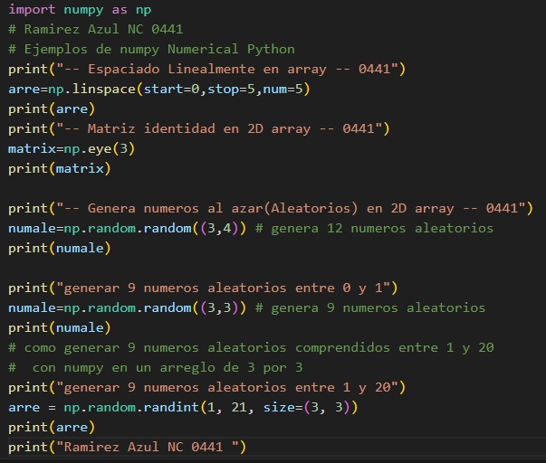
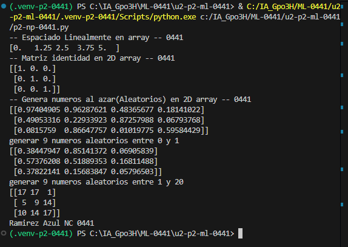

start=0: Indica el número donde comienza el arreglo.

stop=1: Indica el número donde termina el arreglo.

num=5: Indica que se generarán 5 números.

## que es np.linspace
linspace() es una función de NumPy que sirve para generar números igualmente espaciados entre un valor inicial y uno final.

## el codigo

## resultado
